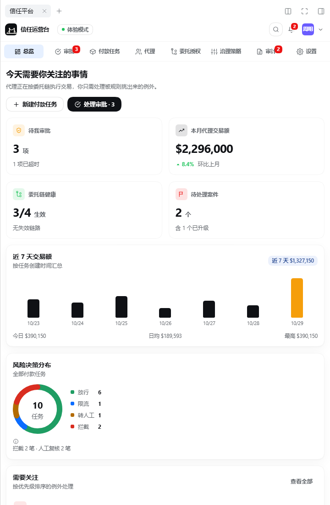
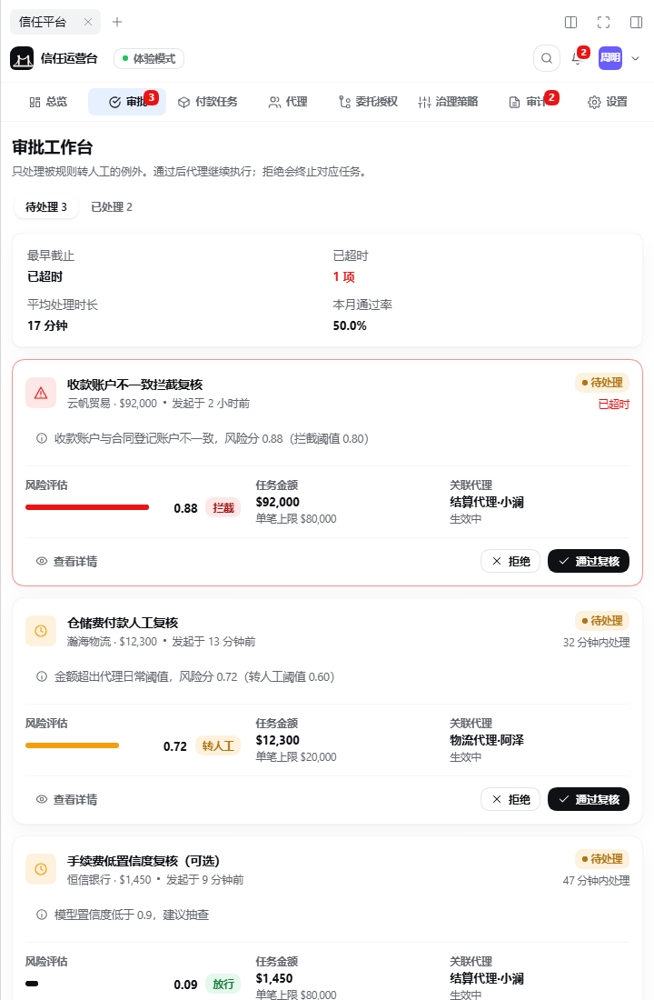

# DSH Trust Platform Plugin

DeepSeek Harness bundle plugin exposing identity, delegation and payment-governance tools for agent
payment workflows. The whole trust plane runs **inside the plugin process**: there is no external
control-plane service, no HTTP backend to deploy, and no `baseUrl` or bearer token to configure.

The embedded engine keeps its records in a profile-owned data directory and runs deterministically
offline. A sandbox mode uses an in-memory store for experiments; it is explicitly non-authoritative.

The plugin never sends money or settles value in either mode.

## Install

```sh
npm install @sealwax/dsh-trust-platform
```

The package declares `dsh.bundle.patch`, so `dsh plugin` composes it into a profile:

```sh
dsh plugin --profile demo add @sealwax/dsh-trust-platform
dsh --profile demo --dump-config   # shows the trust-platform-tools row
```

A local checkout can be linked the same way with `dsh plugin --profile demo add /path/to/code-dsh`.

## Configuration

The profile row keeps host-side settings only. Runtime trust settings — actor DID, intervention gate,
policy version, amount limits, risk thresholds and the default trust score — are edited in the Web
GUI: **Settings → Trust Platform** (see [Settings panel](#settings-panel)). The embedded engine owns
its data directory, so the profile does not configure a control-plane address or token.

Invalid configuration fails plugin load with an actionable error instead of falling back to unsafe
defaults. See [Plugin configuration](docs/plugin-configuration.md) for the host configuration
reference.

## Tools

The host half registers the identity and payment-governance tools of the embedded engine under the
same names the plugin has always used (`register_identity`, `get_identity_status`,
`verify_credential`, `check_authorization`, `create_payment_task`, `get_risk_decision`,
`verify_operation_event`, `get_execution_receipt`, …). The embedded catalog exposes **60 tools** in
embedded and sandbox mode (**61** when the intervention gate is enabled:
`execute_intervention` appears only then). Two depth tools are new in 0.7.0:
`read_delegation_chain` resolves a delegation chain root → leaf and reports its effective limits and
`chain_trustworthy`; `settle_payment_task` applies a signed `FINAL SETTLE` close-loop
(`CONFIRMED → AUDITED → CLOSED`) and refuses when verification is not `VALID`. Neither moves funds.

In the conversation, eight governed calls render as compact trust cards: a localized title, a status
badge, the result's `decision` badge when present, a one-line code/message summary and a raw-JSON
disclosure. Unrecognized payloads degrade to the raw text instead of throwing.

## Browser UI

The DSH Web GUI loads the prebuilt `lib/client.js` bundle lazily. The package declares `dsh.client`
(`platform: web`) and ships the bundle, so `dsh plugin add` activates it without a build step. The
bundle is a lazy CommonJS factory (`window.__ModuleLoader__.load`) whose only bare imports are shell
baseline modules (`react`, `react/jsx-runtime`).

- **Tool renderers** for the eight governed calls listed above, keyed in `tool.call.toolview`.
- **Plugin overview panel** in Settings → Plugins → DSH Trust Platform: engine mode (`embedded` /
  `sandbox`), source and authoritative flags, health status, the six entity counters (identities,
  credentials, authorizations, tasks, events, receipts) and the ten most recent events. It polls the
  same-origin route `GET /trust-platform/api/overview` every 5 seconds and keeps the last good
  snapshot if a refresh fails.
- **Package badge** showing the active trust-platform package version.
- **Settings panel** in Settings → Trust Platform: a live status header (mode, data directory,
  health, schema revision, start time) and an editable form for the actor DID, the
  intervention-execution gate and the policy limits. The page polls `GET /trust-platform/api/settings`,
  `GET /trust-platform/api/health` and `GET /trust-platform/api/storage` every 10 seconds while
  mounted, keeps unsaved edits on screen across refreshes, and renders the Host's `422` validation
  message instead of discarding the form.
- **Data management** in the same page: a storage card (state file, size, schema revision, last save,
  recovery and `write_error` states), a JSON download of the full engine state, and a reset of all
  trust records behind a typed `RESET` confirmation; runtime settings are kept.

### Settings panel

| Control | Field | Notes |
| --- | --- | --- |
| Actor DID | `actorDid` | 3–200 characters; default actor for engine calls. |
| Intervention gate | `allowInterventionExecution` | Enables `execute_intervention`; off by default. |
| Policy version | `policyVersion` | 3–120 characters. |
| Amount limits | `singleAmountLimit`, `dailyAmountLimit` | Positive amounts up to 1,000,000,000,000. |
| Risk thresholds | `riskBlockThreshold`, `riskDeferThreshold`, `riskThrottleThreshold` | Numbers between 0 and 1; block ≥ defer ≥ throttle. |
| Default trust score | `defaultTrustScore` | Number between 0 and 1. |

Save sends only changed fields (`PUT /trust-platform/api/settings`); apply defaults fills the form
from the engine's startup policy; reset deletes engine records (`POST /trust-platform/api/reset`,
body `{ "confirm": true }`) and keeps the runtime settings. The data-management section reads
`GET /trust-platform/api/storage`, downloads the state JSON from `GET /trust-platform/api/export`
(8 MiB cap) and enables the reset button only after `RESET` is typed into the confirmation field.
All routes are same-origin, use the GUI session and are rendered as localized, retryable states on
`403`, `404`, `413`, `422`, `500`, `503`, invalid JSON or network failure. The browser half sends no
telemetry and no data leaves the DSH origin.

### Localized plugin metadata

`locale/en.json` and `locale/zh.json` describe the plugin for the harness plugin manager:
`meta.title`, `meta.description` and `meta.detail`, where the detail page is
[docs/DETAIL.md](docs/DETAIL.md) for English and [docs/DETAIL.zh.md](docs/DETAIL.zh.md) for Chinese.
Both dictionaries ship in the package and are selected by the harness language chain.

The bundle is committed at `lib/client.js` and rebuilt from source with esbuild:

```sh
npm run build:client   # src/client/index.jsx -> lib/client.js (lazy-CJS wrapper, size check)
```

`src/client/` holds the source: `index.jsx` (registrations), `toolviews.jsx`, `overview.jsx`,
`settings.jsx`, `settings-data.js` (transport, patch and validation model), `settings-store.js`
(polling hook), `overview-data.js` (shared overview transport), `locales.js` (zh/en dictionaries),
`format.js` (payload parsing), `styles.js` (inline styles using DSH design-token CSS variables
with fallbacks) and `product/` (the 0.8.0 product workspace: `app/`, `pages/`, `ui/`, `mock/`). `tests/client-bundle.test.js` builds the bundle, executes it in a `node:vm` sandbox
with stubbed baseline modules and the `fetch` stub, and asserts the registered slots, the settings
form markers, the locale metadata, the module envelope and the absence of non-baseline imports —
offline and without a browser.

## Product workspace (0.8.0)

The 0.8.0 release adds the first product surface on top of the governed tools: a **trust operations
workspace** that docks into DSH’s right Sidebar from a workspace button in the conversation header. The
conversation stays in view beside it, DSH’s own column controls close it, and everything inside is
rendered by the plugin — no separate web app, no extra port.





The workspace ships eight tabs, in the order an operator actually works:

| Tab | What it answers |
| --- | --- |
| 总览 / Overview | What needs attention today: pending approvals, month volume, delegation health, open cases, 7-day volume, risk-decision mix, recent signed events, agent activity. |
| 审批 / Approvals | The escalated exceptions only. Each card carries the risk score, task amount, executing agent and the delegation context needed for an approve/deny decision with an audit note. |
| 付款任务 / Payment tasks | Every payment with its risk decision, status, 7-step progress, executing agent and a full detail page (chain, effective limits, audit events, reviews, evidence, settlement). |
| 代理 / Agents | The agent roster as a workforce: trust score, monthly volume, success rate, declared capabilities and credentials, plus per-agent detail pages. |
| 委托授权 / Delegations | The delegated authority chain: per-link and chain-wide limits, used-today totals, validity windows, remaining validity and revocation. |
| 治理策略 / Governance | Risk policy versions, thresholds (block / step-up / throttle), model revisions, drafts and the publish action with version history. |
| 审计与案件 / Audit & cases | Cases under investigation, planned evidence coverage and reports, with per-case detail and investigation records. |
| 设置 / Settings | Organization profile, workspace preferences, demo-data export and a typed-`RESET` restore. |

Phase 1 (this release) runs on a local **demo world** persisted to `localStorage`, so the workspace
is fully interactive without a backend: approvals move tasks forward, settlement closes a task and
appends a verified final event, publishing a draft policy updates the thresholds, and the demo data
can be exported or reset. The store is deliberately isolated behind `subscribe / getSnapshot /
actions`; phase 2 will replace it with the embedded engine's browser route and phase 3 with real
money movement through licensed providers. The workspace UI is Chinese-first, follows the DSH theme
tokens (light and dark) and uses no term a finance operator would not recognize.

Like every other 0.8.0 screen, the workspace is plain static assets inside the plugin package. It
adds no network calls besides the DSH session and does not change the tool catalog or the safety
invariants below.

## Package exports

- `@sealwax/dsh-trust-platform` — the host half the profile composes.
- `@sealwax/dsh-trust-platform/client` — the prebuilt browser bundle (`lib/client.js`).
- `@sealwax/dsh-trust-platform/cordis.patch.yml` — the bundle patch.
- `@sealwax/dsh-trust-platform/locale/*.json` — the localized plugin metadata.
- `@sealwax/dsh-trust-platform/package.json` — package metadata.

Since 0.6.0 the trust plane runs entirely in-process; the legacy `./control-plane-client` subpath
export of the external-service adapter has been removed.

## Safety invariants

- No `send_money`, transfer, payout or settlement tool exists in any mode. `create_payment_task`
  records an intent; settlement is out of scope and `get_execution_receipt` says so honestly.
- `check_authorization` performs a deterministic, conservative check of the delegation record:
  status, validity window, delegated action, subject binding, amount/daily limits, asset scope and —
  when the task is supplied — root issuer. Missing or unreadable data yields `DEFER`, never `ALLOW`.
- A risk decision never grants payment authorization: `get_risk_decision` reports
  `authorization_effect: "NONE"`.
- `verify_operation_event` with an unsigned/unverified event reports `UNKNOWN`, never `VALID`.
- Warning-level or step-up decisions do not pass as approvals; only an explicit `ALLOW` authorization
  can be used by `create_payment_task`.
- `execute_intervention` is absent unless `allowInterventionExecution` is explicitly enabled, and it
  applies an intervention decision rather than moving funds itself.
- The browser half only knows the fixed same-origin routes; callers cannot request arbitrary URLs.
- The embedded engine marks its results authoritative; sandbox results are explicitly non-authoritative
  and unknown or unreadable data never yields `ALLOW`.

## Release notes

### 0.9.2 · Brand and finishing touches

- A new brand mark for 信任运营台 / Trust Operations Console: a solid suspension-bridge silhouette
  on a flat ink tile, monochrome and legible from the 44 px plugin card down to the 16 px header
  control. The gradient shield tile is gone from the plugin icon, console header, header launcher
  and detail-page artwork.
- The plugin detail page now describes the finished product only: the “接下来 / Next” roadmap block
  and “later release” promises were removed, and the preview artwork was redrawn as a brand banner.
- Technical strings on the detail-page overview panel were productized: health reads “正常 / Healthy”,
  recent activity uses product event names (凭证签发、准入检查、付款任务进度) and readable actor names.

### 0.9.1 · Contrast hotfix

- Status chips (待处理 / 生效中 / 放行) in the light theme were still too pale to read at a glance;
  their label tone now mixes toward the foreground colour so every chip passes the contrast audit in
  both themes.

### 0.9.0 · Product experience

- The workspace now reads like a product, not an engineering console: page copy, settings and empty
  states use the language of payment operations, and developer-facing vocabulary (engine modes,
  schema revisions, raw demo data) is either removed or moved behind a “技术详情 / Technical details”
  disclosure.
- A first-run guide explains the workflow in three steps (set boundaries → let agents work →
  handle exceptions); a “体验模式 / Preview mode” chip explains what the sample workspace is and is
  not, replacing the old sandbox wording.
- Settings were rebuilt for operators: workspace profile, notification and display preferences,
  data-and-backup actions, and an about section, with the technical fields tucked into a disclosure.
- The plugin detail page is now a product overview (why you need it, what is inside, a typical day,
  safety boundaries, privacy, FAQ) in both Chinese and English, and the package metadata was
  rewritten to match.
- Light and dark themes both pass the contrast audit; the full suite (159 offline tests) is green.

### 0.8.2

- Dark-mode contrast fixes for the trust console: primary buttons now use DSH’s primary-fill /
  foreground pair instead of the brand text token (previously white-on-white in dark mode), semantic
  status colors follow the shell’s success / warning / danger / business tokens, native controls
  inherit the shell color-scheme, and list rows no longer leak the browser’s default button chrome.
- Dialog and drawer overlays are scoped to the sidebar column, so the conversation beside it stays
  undimmed and the column’s own controls stay reachable; small docked-width spacing fixes.
- 159 offline tests green; verified against a real DSH session in both light and dark themes.

### 0.8.1

- The trust console is now a tab in DSH’s right Sidebar, opened from a workspace button in the
  conversation header; the chat stays visible beside it and the column’s own close control returns
  to the conversation. No more full-frame takeover and no dead end.
- Docked layout pass: compact top bar, fitting tab strip, single-column detail pages, responsive
  tables, dialogs scoped to the column (Escape closes), popovers anchored inside the column, and
  narrow-window reflow.
- 159 offline tests green; the browser bundle is still built from source at pack time.

### 0.8.0

- New trust console with a full product workspace: Overview, Approvals, Payment tasks, Agents,
  Delegations, Governance, Audit and Settings.
- Full operator flows on a local demo world: approve/deny with audit notes, create a payment task,
  submit settlement, revoke a delegation, publish a draft policy, export and reset demo data.
- Task detail reconstructs the authorizing chain, effective limits, audit events, reviews and
  evidence; agent and case pages expose the full trail behind an exception.
- The workspace is Chinese-first, theme-token based (light/dark) and ships inside the plugin bundle;
  no extra process, port or service.

### 0.7.1

- Fix the settings-page “Export data” button: the download helper only accepted an object-shaped
  `URL` global, but browsers expose `URL` as a constructor, so the 0.7.0 export always fell into its
  failure branch. The guard now accepts function and object shapes, and a build assertion keeps the
  constructor-safe guard from regressing.

### 0.7.0

- Tool catalog grows to 60 tools in embedded/sandbox mode (61 with the intervention gate enabled):
  `read_delegation_chain` resolves a delegation chain root → leaf with effective limits and
  `chain_trustworthy`, and `settle_payment_task` runs a signed `FINAL SETTLE` close-loop
  (`CONFIRMED → AUDITED → CLOSED`) that refuses when verification is not `VALID`.
- Multi-level delegation chains: `check_authorization` follows delegated capabilities across
  multiple links and fails closed with `DEFER` on a broken, expired or over-scoped link.
- Signed settlement close-loop: settlement evidence is linked back to tasks, receipts and audit
  records; the engine still never moves funds.
- Governance policy and risk-model activation: policy versions and model revisions can be activated
  at runtime in addition to the editable limits and thresholds.
- Data management: a storage card, JSON export and a typed-`RESET` reset of all engine records on
  the settings page.
- Crash recovery: the embedded engine restores its state file after a restart and reports the
  recovery result in the data-management card.

### 0.6.0

- The trust plane moved in-process; the external control-plane adapter and its
  `./control-plane-client` export were removed.

## Development

```sh
npm test             # node --test tests/*.test.js (offline, stubbed fetch)
npm run build:client # rebuild lib/client.js from src/client/
npm run pack:check   # rebuild the browser bundle, then npm pack --dry-run
```

The tests never use the network or a live server; the bundle test rebuilds `lib/client.js` first so
the committed artifact and the source cannot drift. `tests/scenario-full-chain.test.js` runs the
complete DID → credential → payment task → delegation → authorization → operation event → risk →
intervention → case → report chain through the registered tools and the browser API, asserts that
every fail-closed path stays closed (a `DENY` authorization can never create a task, unsigned events
never verify as `VALID`), and checks that the whole chain survives in `state.json`.
Requires DSH `>=0.2.1-rc.3 <0.3.0`
(`engines.dsh`) and `@deepseek-ai/cordis ~4.0.5`.
