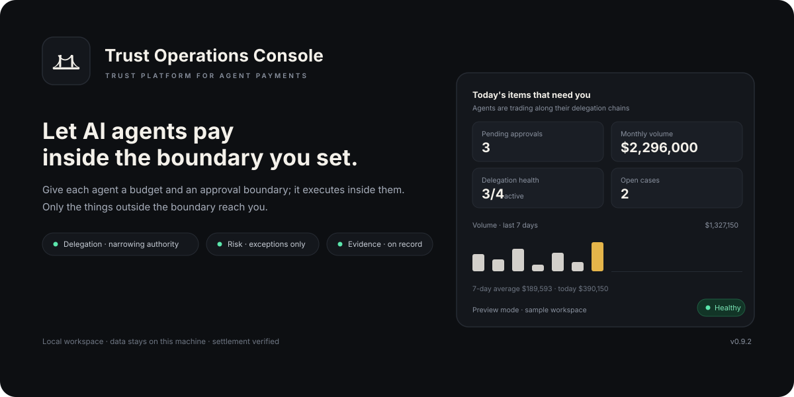

# Browser half — detail



Release 0.3.0 adds a browser half to `@sealwax/dsh-trust-platform`. The DSH Web GUI loads it lazily
from the prebuilt `lib/client.js` bundle: it renders the eight governed trust tools as compact cards
in the conversation and adds an overview panel to the plugin's detail page. The browser half talks
only to the DSH origin that served it.

## Where it appears

| Surface | Slot (id / key) | What it shows |
| --- | --- | --- |
| Conversation tool call | `tool.call.toolview`, one entry per key | Trust card for that tool call: title, status badge, decision badge, one-line summary, raw JSON disclosure. |
| Settings → Plugins → DSH Trust Platform | `plugins.detail.section`, id `trust-platform-overview` | Overview panel: mode, source, authority, health, six counters, ten most recent events. |
| Same plugin page | `plugins.detail.badge`, id `trust-platform-badge` | Version pill for the active trust-platform package. |

Both plugin-manager entries match the package by name (`@sealwax/dsh-trust-platform`) — via the
package subject, the row name or a bare id — and return `null` for any other package, so they never
draw chrome on unrelated plugin pages.

## Tool cards

The registered `tool.call.toolview` keys are: `register_identity`, `get_identity_status`,
`verify_credential`, `check_authorization`, `create_payment_task`, `get_risk_decision`,
`verify_operation_event`, `get_execution_receipt`.

Each card reads the canonical tool result — a single text block containing JSON from `succeeded()` or
`failed()`. It derives:

- **status** `ok` when `ok: true`, `failed` when `ok: false` or the result is an error, `running`
  while the call is still pending;
- **decision** from the result's `decision` field when present (`ALLOW`, `DENY`, `DEFER`, `REVIEW`,
  `STEP_UP`, …), toned green/red/amber by family;
- **summary** from `code` and `message`, falling back to the raw text (truncated) for non-JSON
  payloads;
- **raw JSON** behind a disclosure toggle, rendered in a monospace block.

Malformed or unexpected payloads never throw: the card falls back to the raw text or a localized
placeholder.

## Overview panel

The panel polls the same-origin route `GET /trust-platform/api/overview` every 5 seconds while
mounted and renders a `200` body of the documented shape:

```json
{
  "ok": true,
  "plugin": { "name": "dsh-trust-platform", "version": "0.3.0", "mode": "control-plane",
              "source": "control-plane", "authoritative": true, "started_at": "..." },
  "health": { "status": "ok", "service": "trust-core", "schema_revision": "42" },
  "counts": { "identities": 128, "credentials": 64, "authorizations": 512,
              "tasks": 23, "events": 2048, "receipts": 18 },
  "recent_events": [
    { "event_type": "authorization.allowed", "actor_did": "did:agent:payments-7f3a",
      "occurred_at": "2026-10-27T04:04:31Z", "decision": "ALLOW" }
  ],
  "now": "..."
}
```

In-memory mode reports `mode: "in-memory"`, `authoritative: false`, empty counters and no recent
events; the panel labels the snapshot as non-authoritative rather than hiding it. The panel accepts
the snapshot either flattened (as documented above) or wrapped in an `overview` key, so the two
halves can be updated independently. Every load-state is
covered: loading, empty, stale (a failed refresh keeps the last good snapshot), and error. A `403`,
`404`, `500`, invalid JSON or network failure becomes a localized message with a retry button; the
panel never renders a blank or broken frame.

## Safety and privacy

- **Same origin only.** The only request is the fixed `GET /trust-platform/api/overview` with
  `credentials: "same-origin"`; no external hosts, no telemetry, no analytics.
- **Read-only.** The browser half never writes trust state and has no tool that moves money; the
  safety invariants of the host half remain unchanged.
- **No secrets in the browser.** The control-plane token and actor DID are host-side configuration
  and are not exposed to the bundle.
- **Localized and defensive.** All visible copy lives in typed `zh`/`en` dictionaries; both stay
  key-identical and English is the fallback. Inline styles use DSH design-token CSS variables with
  light/dark-safe fallbacks, so the cards and panel follow the GUI theme.

## Configuration

No browser-side configuration is required: the panel reads `mode` and `source` from the route
response, which the host half derives from the plugin row's `mode` configuration
(`in-memory` or `control-plane`). The route path is fixed, so a profile keeps the default route and
needs only the plugin installed. If the GUI session is not allowed to call the route, the panel shows
the localized `403` state and keeps retrying on demand.

## Build and test

```sh
npm run build:client  # esbuild 0.25.12: src/client/index.jsx -> lib/client.js (lazy-CJS wrapper)
node --test tests/client-bundle.test.js
npm run pack:check    # rebuild the bundle, then npm pack --dry-run
```

The build wraps the CJS body in `window.__ModuleLoader__.load({ id, factory })`, rejects any bare
`require()` outside the shell baseline list, and fails if the bundle exceeds 128 KiB. The current
bundle is about 33 KB and imports only `react` and `react/jsx-runtime`.

`tests/client-bundle.test.js` runs offline with no browser: it builds the bundle, executes it in a
`node:vm` sandbox with stubbed baseline modules and a fake `window.__ModuleLoader__`, calls the
factory and `apply()` against a fake client context, and asserts the envelope, the eight keyed
renderers, the two plugin-manager entries with their ids, the zh/en dictionary parity, the
pure-formatting helpers and the absence of non-baseline imports.

## Files

| File | Role |
| --- | --- |
| `src/client/index.jsx` | `apply`/`inject` and all slot registrations. |
| `src/client/toolviews.jsx` | `ToolCard` and the eight `tool.call.toolview` keys. |
| `src/client/overview.jsx` | Overview section, badge, polling and error states. |
| `src/client/locales.js` | `trust-platform` namespace with `zh`/`en` dictionaries. |
| `src/client/format.js` | Payload parsing, decision/status/summary derivation, plugin matching. |
| `src/client/styles.js` | Inline style constants with CSS variable fallbacks. |
| `scripts/build-client.mjs` | esbuild build, wrapper, baseline-require guard, size budget. |
| `lib/client.js` | Generated lazy-CJS bundle shipped in the package. |
| `tests/client-bundle.test.js` | Offline bundle contract tests. |
| `docs/preview.svg` | This document's mock panel (640×300, self-contained SVG). |
