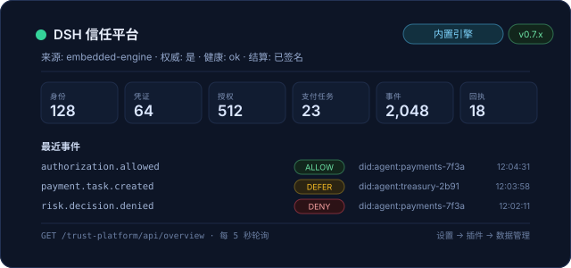

# 信任平台

面向多智能体跨境支付工作流的嵌入式身份与支付治理信任平面。整个信任平面运行在 **DSH 插件进程内部**：
无需部署外部控制平面服务，没有 HTTP 后端，也不需要配置 `baseUrl` 或 bearer token。引擎把记录保存在
profile 自己的数据目录中，离线确定性运行，并且自身不转移任何资金。

沙箱模式使用内存存储用于实验，并被明确标记为非权威：沙箱记录永远不能作为信任决策的依据。两种模式下
插件都不会发起转账或结算资金。

## 0.8.0 更新


- **产品工作台**：插件现在在 DSH 全局侧边栏提供“信任平台”入口，点开就是一个完整的运营工作台，
  包含总览、审批、付款任务、代理、委托授权、治理策略、审计与案件、设置八个页面。
- **完整操作闭环（演示数据）**：在演示数据上可以完成通过/拒绝人工复核并留下审计备注、新建付款
  任务、提交结算、撤销委托、发布策略草稿、导出与重置演示数据。数据保存在浏览器本地，
  不依赖任何后端服务。
- **可核对的上下文**：任务详情页还原授权链与逐级收紧的有效额度、审计事件、人工复核记录与证据；
  代理与案件详情页展示异常背后的完整轨迹。
- **中文优先与主题一致**：工作台全部使用中文界面与金融运营熟悉的语言，跟随 DSH 明/暗主题。
- 本阶段全部为前端界面；产品化打磨与接入真实引擎/真实资金会在后续阶段进行。

## 0.7.0 更新

- **工具目录扩展到 60 个工具**（启用干预执行开关后为 61 个）：`read_delegation_chain` 解析
  从根到叶的委托链并报告有效上限与 `chain_trustworthy`；`settle_payment_task` 执行带签名的
  `FINAL SETTLE` 结算闭环（`CONFIRMED → AUDITED → CLOSED`），验证结果不是 `VALID` 时拒绝执行。
- **多级委托链** —— 授权可以沿委托链跨越多级链接；任何断裂、过期或越权的链接都会以 `DEFER`
  失败关闭，绝不会返回 `ALLOW`。
- **带签名的结算闭环** —— 支付任务可以基于带签名的结算凭据完成闭环，执行回执与审计记录都会链接回可
  验证的结算记录。引擎只记录凭据，仍然不转移资金。
- **治理策略与模型生效** —— 除了可编辑的金额上限和风险阈值外，策略版本与风险模型版本也可以在运行时
  激活生效。
- **数据管理** —— 设置页新增状态文件存储卡片、完整引擎状态的 JSON 下载，以及需要输入 `RESET`
  确认的数据重置。
- **崩溃恢复** —— 嵌入式引擎重启后会从状态文件恢复数据，并在数据管理卡片中报告恢复结果。

## 功能一览

- 嵌入式信任平面：身份、委托、支付任务、操作事件、风险与执行回执记录保存在 profile 的数据目录中。
- 产品工作台（0.8.0 起）：DSH 主面板内的总览、审批、付款任务、代理、委托授权、治理策略、
  审计与案件和设置页面，基于本地演示数据的完整操作闭环。
- 对话中的八张紧凑信任卡片：本地化标题、状态徽标、结果中的 `decision` 徽标（存在时）、单行
  代码/消息摘要，以及原始 JSON 展开。
- 插件概览面板（设置 → 插件 → DSH Trust Platform）：每 5 秒轮询引擎，刷新失败时保留最后一次
  成功快照。
- 可编辑设置页（设置 → 信任平台）：角色 DID、干预执行开关与风险策略上限。
- 数据管理区：存储卡片、JSON 导出与受保护的整库重置。
- 供 harness 插件管理器使用的本地化元数据：中英文详情页。

## 安装

```sh
npm install @sealwax/dsh-trust-platform
dsh plugin --profile demo add @sealwax/dsh-trust-platform
dsh --profile demo --dump-config   # 显示 trust-platform-tools 配置行
```

本地检出也可以用 `dsh plugin --profile demo add /path/to/code-dsh` 以同样方式挂载。嵌入式引擎
自行管理数据目录，profile 中无需配置控制平面地址或 token。

## 设置用法

页面挂载期间每 10 秒读取 `GET /trust-platform/api/settings` 与
`GET /trust-platform/api/health`。保存时只把改动过的字段发送给
`PUT /trust-platform/api/settings`；被拒绝的补丁返回 `422`，其消息会渲染在表单旁而不会丢弃
操作者的修改。未保存的编辑在轮询刷新后仍然保留，取消恢复到最后一次保存的值，填入默认值则使用引擎
启动时的策略填充表单。

| 控件 | 字段 | 说明 |
| --- | --- | --- |
| 角色 DID | `actorDid` | 3–200 个字符；引擎调用使用的默认角色。 |
| 干预执行开关 | `allowInterventionExecution` | 启用 `execute_intervention`；默认关闭。 |
| 策略版本 | `policyVersion` | 3–120 个字符。 |
| 金额上限 | `singleAmountLimit`、`dailyAmountLimit` | 正数，最大 1,000,000,000,000。 |
| 风险阈值 | `riskBlockThreshold`、`riskDeferThreshold`、`riskThrottleThreshold` | 0 到 1 之间；阻断 ≥ 延后 ≥ 限流。 |
| 默认信任分 | `defaultTrustScore` | 0 到 1 之间。 |

## 数据管理

设置页的数据管理区由 `GET /trust-platform/api/storage` 驱动：数据目录、状态文件、文件大小、文件
是否存在、最后保存时间、schema 版本与恢复状态。`write_error` 会以警告形式显示而不是隐藏卡片；
宿主缺少存储能力时显示本地化的 `503` 状态。

- **导出数据**：通过 `GET /trust-platform/api/export` 下载完整引擎状态 JSON（附件名
  `trust-platform-state-<时间戳>.json`，最大 8 MiB；状态更大时返回 `413`）。导出失败时保留页面
  上的最后一次快照。
- **重置数据**：通过 `POST /trust-platform/api/reset`（请求体 `{"confirm": true}`）删除全部引擎
  记录；只有操作者在确认框中输入 `RESET` 后按钮才可用。重置后运行时设置保留。
- **刷新**：重新读取存储卡片与设置快照。

所有路由均为同源、使用 GUI 会话，`403`、`404`、`413`、`422`、`500`、`503`、非法 JSON 或网络
失败都会渲染为本地化、可重试的状态。浏览器端不发送任何遥测数据，数据不会离开 DSH 源。

## 对话中的工具

八个受治理的调用 `register_identity`、`get_identity_status`、`verify_credential`、
`check_authorization`、`create_payment_task`、`get_risk_decision`、`verify_operation_event` 与
`get_execution_receipt` 会渲染为信任卡片。其他引擎工具（包括 `read_delegation_chain` 与
`settle_payment_task`）使用宿主默认工具行。宿主返回规范的 `succeeded()`/`failed()` JSON 信封，
卡片防御性地解析它；负载异常时回退到原始文本，坏结果永远不会让对话抛错。

## 数据与隐私

一切离线运行：没有遥测、没有外部网络，数据不会离开 DSH 源。浏览器端只认识
`/trust-platform/api` 下的固定同源路由。刷新失败会保留最后一次成功快照；所有失败状态都本地化且可
重试；缺少当前语言的字符串时回退到英文。

## 安全不变量

- 插件从不转移资金。`create_payment_task` 只记录意图，带签名的结算闭环只记录并验证结算凭据，
  两者都不会发起转账。
- `check_authorization` 对委托记录做确定性、保守的检查：状态、有效期窗口、被委托动作、主体绑定、
  金额/每日上限、资产范围，以及在提供任务时检查根签发方。数据缺失或不可读时返回 `DEFER`，绝不
  返回 `ALLOW`。
- 风险决策不会授予支付授权：`get_risk_decision` 报告 `authorization_effect: "NONE"`。
- 未签名/未验证的操作事件经 `verify_operation_event` 检查后返回 `UNKNOWN`，绝不是 `VALID`。
- 警告级或升级验证决策不能当作批准；只有显式 `ALLOW` 授权才能用于 `create_payment_task`。
- 除非显式启用 `allowInterventionExecution`，否则不存在 `execute_intervention`；它只应用干预
  决策，自身不转移资金。
- 嵌入式引擎将其结果标记为权威；沙箱结果明确为非权威，未知或不可读数据永远不会得到 `ALLOW`。

## 构建与测试

```sh
npm run build:client   # src/client/index.jsx -> lib/client.js（lazy-CJS 包装，含体积检查）
node --test tests/client-bundle.test.js
npm run pack:check     # 重新构建 bundle，然后 npm pack --dry-run
```

bundle 测试在 `node:vm` 沙箱中执行 `lib/client.js`，使用 stub 的基线模块与 `fetch`，断言注册的
设置/概览/工具槽位、设置表单与数据管理标记、locale 元数据、lazy-CJS 信封，以及只导入 `react`
模块。测试完全离线，不启动浏览器或服务器。
